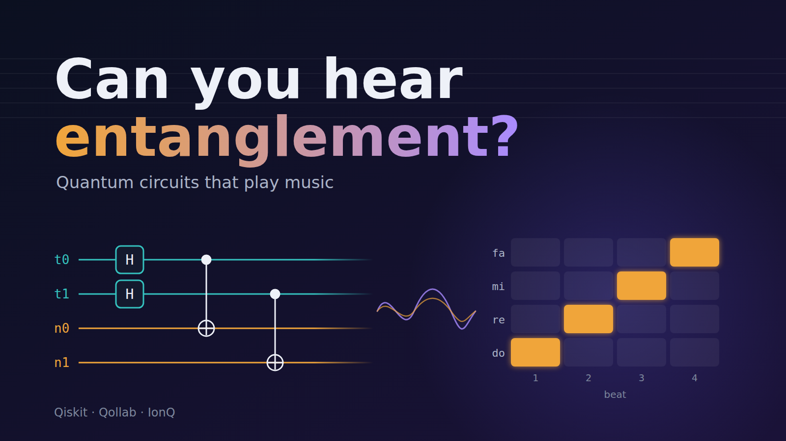
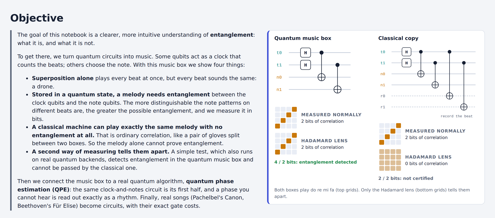

# Can you hear entanglement? A quantum music box

Quantum circuits that play music: hear why a melody needs entanglement, and test it on IonQ.

**3rd place and Best in Quantum Playground, Qollab × IonQ Hackathon 2026.**

- **Run it on Qollab (Qiskit + IonQ):** https://qollab.xyz/u/ehsan/can-you-hear-entanglement
- **Demo video (3 min):** https://youtu.be/vBk-Fj_Znjs
- **Team:** Amir Ayati, Ehsan Ghasempouri, Vivek Das (QuNB group, University of New Brunswick)

*This effort is supported by Qollab & IonQ.*

## The problem and objective

Entanglement is usually explained with equations or with coin and glove analogies. Those analogies are misleading: a pair of gloves in two boxes is *correlated*, not entangled. People come away thinking entanglement is "spooky correlation", and nothing they can see or hear shows them where the line between the two actually is. Our objective is a clearer, more intuitive understanding of entanglement: we turn circuits into music, show why encoding different notes at different beats in a pure quantum state requires time–note entanglement (superposition alone gives a drone), while a classical mixture can reproduce the same melody, and how a second measurement tells the two apart.

## What it does

The Qubit Music Box turns a quantum circuit into a song you can play, and makes that line audible and testable.

- **Time qubits** pick the beat, **note qubits** pick the note, and **instrument qubits** pick piano, guitar, flute or drums (or cello, viola, flute and violin). Each measurement outcome is one note, on one instrument, at one beat.
- **Superposition alone gives a drone or a chord**: Hadamards on the time qubits make every beat happen at once, but each beat plays the same thing.
- **A melody stored in a pure quantum state needs entanglement** whenever different beats carry different notes: the note register depends on the time register. The app measures this as the entanglement entropy between time and notes, in bits. (Reduced-state entropy measures entanglement only for pure states, so it is not used for the classical copy.)
- **Correlation versus entanglement, side by side.** A "classical copy" lets extra recorder qubits record the beat (CNOTs) and never reads them. With the recorder traced out, time and notes form the separable mixture ¼ Σₜ |t⟩⟨t| ⊗ |t⟩⟨t|: the same correlation, no entanglement between them. (The full state including the recorder is still entangled; this is decoherence.) It sounds identical when measured normally. The **Hadamard lens** measures a second way, with a Hadamard gate on every qubit just before measurement: an X-basis measurement instead of the normal Z-basis one. Through the **Hadamard lens** its correlation drops to zero, while the real melody's correlation survives.
- **A real entanglement test.** The two-lens test (Maccone, Bruß & Macchiavello, 2015) proves entanglement when the normal-lens and Hadamard-lens correlations add up to more than log₂(smaller register). It proves *do re mi fa*, a Toffoli melody and *Ode to Joy* entangled. A two-qubit panel makes the same test audible as an 8-shot stereo duet.
- **Runs on real backends in one job.** "Run on the selected backend" sends a single circuit holding two copies of the song: one measured normally, one through the Hadamard lens. That is everything the test needs, so it works on IonQ, which takes one job per run. You can then play back what the backend measured.
- **Physics connection.** The circuit is one frozen state, Σₜ |t⟩|notesₜ⟩. The coherent melody encoding contains time–note entanglement between a clock register and the notes. That is Page and Wootters' "time from entanglement" (1983), and the U-box presets build exactly the history state from the first half of quantum phase estimation.
- **Songs as circuits.** From *Twinkle* to Pachelbel's *Canon* for a four-instrument orchestra and the opening of Beethoven's *Für Elise* (both hands, real pitches, 11 qubits), with exact gate costs from the Qiskit transpiler. Three tricks make long songs cheaper without changing a note: algebraic (Reed–Muller) encoding, a searched choice of which key gets which binary label, and two scratch qubits for the compiler. Together they take *Für Elise* from 9,942 to 2,454 CNOTs.
- **Exact state or shots.** Cells can play the exact state or only what 10 to 10,000 measured shots give (sampled by Qiskit from the state). The song converges as the shots grow: *Für Elise* is 93% off the exact song after 10 shots, 45% after 100, 14% after 1,000 and 4% after 10,000.

## How to run it

There are three ways to run it:

- **On Qollab (full version):** open the [Qollab project](https://qollab.xyz/u/ehsan/can-you-hear-entanglement), press **Run** and follow the steps below. Every circuit is built and computed by Qiskit, and section 7 runs on IonQ.
- **In your browser (preview):** serve this folder with any static server, for example `python -m http.server`, and open `http://localhost:8000/preview.html`. The preview plays every cell with the built-in JavaScript simulator, so Qiskit checks, live gate counts and backend runs are only available on Qollab. Enabling GitHub Pages for this repository publishes the same preview at `/preview.html`.
- **Tests:** `pip install -r requirements.txt`, then `python -m pytest tests`.

On Qollab, the project is a **notebook**: one page that tells the story in ten short sections, with notes, worked examples, live figures and circuits you can play. The full Music Box editor sits at the end as a lab.

1. Press **Run** and pick a backend in the Select QPU dialog. The built-in simulator is the quickest.
2. Read from the top and press **▶ Play** on each circuit cell. Every outcome in a beat sounds at once, louder the more likely it is, so a superposition of notes is heard as a chord.
3. In section 6, switch a cell between **Quantum circuit** and **Classical copy**, and between **Normal measurement** and **Hadamard lens**.
4. In section 7, press **Run on the selected backend**: one job measures both lenses, then play what the backend measured.
5. Open the lab at the end to build your own circuit (click a cell, or use the arrow keys and Enter).

## How it works

| File | Role |
|---|---|
| `musicbox/circuit.py` | Builds the Qiskit `QuantumCircuit` from the editor's JSON: multi-controlled gates, the link-strength dial, U step-up boxes (a ripple-increment cascade of MCX gates), the classical-copy recorder, and the two-lens circuit. |
| `musicbox/engine.py` | What the interface calls: the exact state (`Statevector`) with entanglement entropies (`partial_trace`, `entropy`), the exact compiled cost (`transpile`), and the one-job backend run with a bias-corrected bootstrap test. |
| `index.html`, `main.css`, `main.js` | The notebook page: the story text, and the start-up code that connects the cells to Qiskit. |
| `notebook/box.js` | A playable circuit cell: diagram, controls, piano roll, Play, and readouts from Qiskit's state. |
| `notebook/sim.js` | Turns a state into what you hear: probabilities, the Hadamard and QFT lenses, the classical copy, correlations, the overlap table and entanglement. Also a browser simulator that cross-checks Qiskit. |
| `notebook/songs.js`, `notebook/draw.js`, `notebook/audio.js`, `notebook/notebook.js` | The circuits used in the story (with lookup and algebraic encoders), the SVG figures, the synthesized instruments, and the wiring for figures, the duet, the backend run and the cost table. |
| `lab/musicbox.js` | The full Music Box editor at the end of the notebook. |
| `tests/test_musicbox.py` | Checks run locally (`python -m pytest tests`). |
| `preview.html`, `preview.js` | The same page for any web browser, played by the JavaScript simulator (no Qiskit). |
| `media/` | Cover image and screenshots. |

- **Qiskit computes the state you hear.** A small JavaScript simulator answers instantly while Qiskit works, and every Qiskit result is cross-checked against it. They agree to 10⁻¹² on every preset.
- **Shot-based results are careful, not rigorous.** Finite shots inflate mutual information. The backend test applies a bias-corrected bootstrap and reports "entanglement detected" only when (1) there are at least 10 shots per possible outcome and (2) the approximate 95% lower bound clears the limit by 0.02 bits. Both are **empirical guardrails, not mathematical guarantees**. We tested them by simulation, sampling shots from exact distributions:

  | State | Shots | Wrongly detected | Correctly detected | Exact total vs limit |
  |---|---|---|---|---|
  | do re mi fa, classical copy / real | 200 / 1,000 / 4,000 | 0/100 each | real: 100/100 each | copy 2.00, real 4.00 vs 2 |
  | do do re fa, classical copy / real | 200 / 1,000 / 4,000 | 0/100 each | real: 100/100 each | real 2.31 vs 2 |
  | Ode to Joy, classical copy / real | 1,280 / 4,000 | 0/40 each | real: 40/40 each | real 3.58 vs 3 |
  | Canon (9 qubits), real | 5,120 / 8,000 | 0/40 each (exact total is below the limit) | – | 3.90 vs 4 |
  | Separable, on the boundary, correlated in **both** lenses (Z-copy on t0–n0, X-copy on t1–n1) | 160 / 640 | 0/100 each | – | 1 + 1 = 2 vs 2 |
  | Same idea, 4+3 qubits (Z-copies on two pairs, X-copy on one) | 1,280 / 5,120 | 0/100 each | – | 2 + 1 = 3 vs 3 |

  Without rule (1), 200 shots of the Canon were "detected" in 60/60 runs although its exact total is below the limit. In the 4+3 boundary test the lower bound reached 3.00 against a limit of 3, which is why the 0.02-bit margin was added. These trials support the tested cases only; they cannot guarantee the behaviour for arbitrary circuits, and the bootstrap interval's coverage is not guaranteed near the boundary. Rigorous finite-shot certification would need separate validation.

## Verified results

Exact values come from Qiskit's statevector. Shot values come from Qiskit's `BasicSimulator`, each run meeting the 10-shots-per-outcome rule.

| Preset | Entanglement, time ↔ rest | Normal + Hadamard correlation | Limit | Verdict |
|---|---|---|---|---|
| Drone | 0 bits | 0 | 2 | none, as expected |
| do re mi fa | 2.00 bits | 4.00 (1,000 shots: 4.00, lower bound 3.99) | 2 | detected (exact and shots) |
| Bell pair (t0 ↔ n0) | 1.00 bit | 2.00 | 2 | whole-register test silent; the two-qubit panel proves it (2 > 1) |
| Toffoli melody | 1.50 bits | 2.31 | 2 | detected (exact) |
| Ode to Joy | 2.40 bits | 3.58 (1,280 shots: 3.56, lower bound 3.48) | 3 | detected (exact and shots) |
| Canon in C (orchestra) | 3.37 bits | 3.90 | 4 | not detected: entangled, but the witness is sufficient, not necessary |
| Classical copy of do re mi fa | 0 (separable mixture) | 2.00 (Hadamard lens 0.00) | 2 | not certified, as it should be |

## How this differs from other quantum music projects

Superposition Sequencer (one qubit per drum track, one shot per beat), Musiq (measured outcomes set pitch and loudness) and Quantum Patterns (live-coded patterns) all map circuit outputs onto sound. None of them has a time register. None makes melody depend on entanglement, separates correlation from entanglement with a classical control, or proves entanglement from shots.

## Accessibility

- Every control is a labelled native button or select, with visible focus outlines.
- Each section has a heading and a contents link; wide diagrams scroll and can be focused by keyboard.
- The lab's circuit grid uses a single tab stop with arrow-key navigation, and every cell has a spoken label (qubit, column, gate).
- The piano roll is also written out as text, beat by beat, and instruments are named in text, not only by colour.
- Status messages use live regions, and reduced-motion settings are respected.

## Limits and honest claims

- The two-lens test is *sufficient*, not necessary: "not certified" does not mean "not entangled".
- The Page–Wootters link is an analogy at the level of the state's structure. The "clock" is a register we choose to play in order. It is not a claim about physical time.
- Larger songs compile to hundreds or thousands of two-qubit gates (Canon 630, Für Elise 2,454, even after compaction). They run on simulators, but would be far too noisy for today's hardware.

## Music

*Für Elise* (Beethoven, 1810) and the Canon (Pachelbel) are public domain; the arrangements and the other tunes are our own or traditional.

## References

- D. N. Page and W. K. Wootters, "Evolution without evolution", *Phys. Rev. D* 27, 2885 (1983).
- E. Moreva et al., "Time from quantum entanglement: an experimental illustration", *Phys. Rev. A* 89, 052122 (2014).
- L. Maccone, D. Bruß and C. Macchiavello, "Complementarity and correlations", *Phys. Rev. Lett.* 114, 130401 (2015).
- E. R. Miranda (ed.), *Quantum Computer Music: Foundations, Methods and Advanced Concepts* (Springer, 2022).

Licence: MIT (see `LICENSE`).
